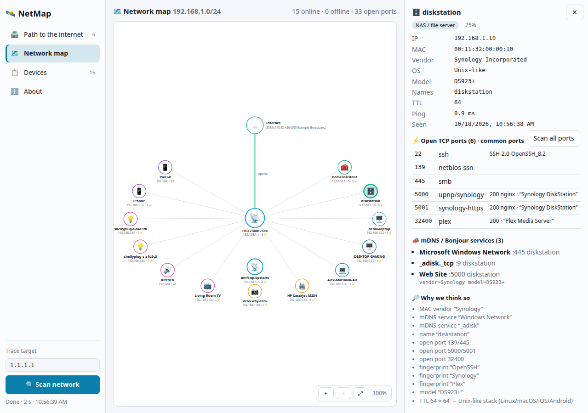

# NetMap

Desktop app that scans your local network and the path to the internet.

- 🛰️ **Path to the internet**: every hop, latency, loss, ASN, VPN detection
- 🗺️ **Network map**: zoomable map of all devices around the gateway
- 📋 **Devices**: open ports, services, vendor, OS, model, with the evidence
  behind each guess
- 🔍 **Deep scan**: all 65,535 ports of one device

No root needed. Results stay on your machine.



## Requirements

Linux, macOS or Windows 10/11. Everything it needs ships with the OS. On Linux,
`mtr` or `traceroute` is needed for the path (`sudo apt install mtr-tiny`).

## Install

Download from [Releases](https://github.com/riagentic/netmap/releases/latest)
(~30 MB; the first start downloads its Electron runtime once):

- 🐧 **Linux**: `netmap-*.AppImage`, then
  `chmod +x netmap-*.AppImage && ./netmap-*.AppImage`
- 🪟 **Windows**: `netmap-*-win-x64.exe`. It is unsigned, so SmartScreen asks
  first: _More info → Run anyway_. If the firewall asks, _Cancel_ is fine.
- 🍎 **macOS**: `netmap-*.dmg` (Apple Silicon or Intel). It is unsigned, so the
  first time: right-click the app → _Open_.

Or build and run from source in one command:

```sh
# Linux, macOS
curl -fsSL https://raw.githubusercontent.com/riagentic/aio/main/run.sh | sh -s riagentic/netmap
```

```powershell
# Windows (PowerShell)
& ([scriptblock]::Create((irm https://raw.githubusercontent.com/riagentic/aio/main/run.ps1))) -Git riagentic/netmap
```

## Develop

Built with [aio](https://github.com/riagentic/aio). Install `am`, then:

```sh
am fix              # link the framework, install deps
deno task dev       # run
deno task test      # test
deno task compile   # build for this OS into dist/
deno task build --targets=electron --platforms=linux,windows,macos-arm64
```

Demo mode scans a made-up network (no probes): `NETMAP_DEMO=1 deno task dev`.

## Privacy

The scan runs locally. Outside requests: `ipinfo.io` (your public IP and
provider), `standards-oui.ieee.org` (vendor list, once a month), and DNS lookups
for hop names and networks (`asn.cymru.com`).

## License

[MIT](LICENSE)
